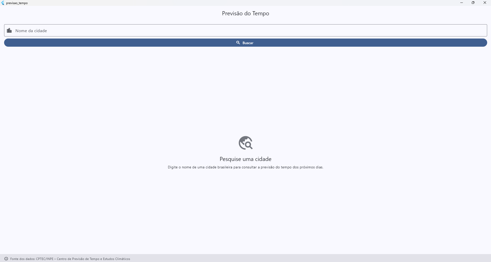
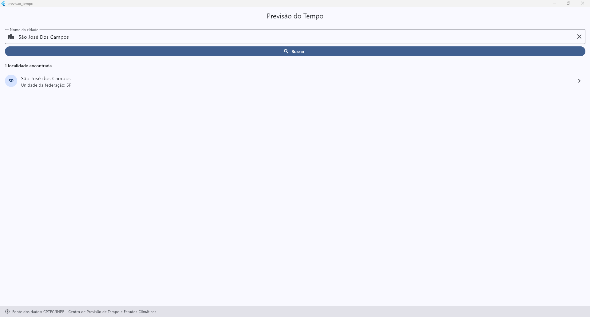
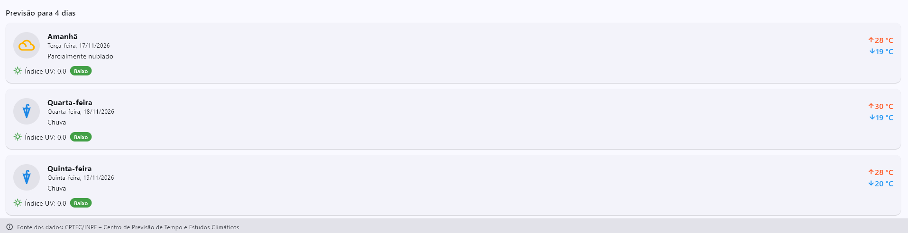
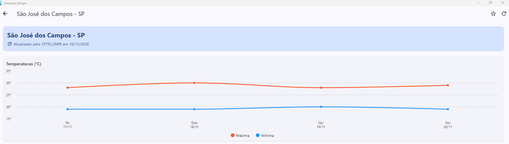

# Previsão do Tempo – CPTEC/INPE

Atividade 2 – Programação para Dispositivos Móveis I (Prof. Arley).

Aplicativo em **Flutter** para consultar a previsão do tempo de cidades brasileiras usando o
serviço XML do **CPTEC/INPE** (<https://servicos.cptec.inpe.br/XML/>). O app pesquisa cidades,
mostra a previsão de quatro dias e um gráfico com as temperaturas mínimas e máximas.

> **Fonte dos dados:** CPTEC/INPE – Centro de Previsão de Tempo e Estudos Climáticos.

---

## Funcionalidades implementadas

### 1. Pesquisa de cidades

- Campo para digitar o nome da cidade (acentos são removidos automaticamente, como o serviço exige).
- Consulta ao endpoint `listaCidades?city=<nome>` do CPTEC/INPE.
- Lista de resultados com **nome da cidade** e **unidade da federação (UF)**; um toque abre a previsão.
- O **código usado na previsão é o `id` retornado pelo próprio serviço**.
- Mensagem **"Nenhuma cidade encontrada"** quando a busca não tem resultados.

### 2. Consulta da previsão do tempo (tela de previsão)

- Consulta ao endpoint `cidade/<código>/previsao.xml` (previsão para 4 dias) e exibição de **todos os dias retornados**.
- Para cada dia:
  - data da previsão (com "Hoje"/"Amanhã" e dia da semana);
  - temperatura **mínima e máxima em °C**;
  - **descrição da condição do tempo**: as siglas (`pn`, `c`, `ps`, `cl`...) são convertidas para o texto da documentação do CPTEC/INPE (tabela completa com as 40 siglas em `lib/utils/condicoes_tempo.dart`);
  - **ícone** representativo da condição;
  - **índice ultravioleta**, quando disponível, com a classificação da OMS (baixo, moderado, alto, muito alto, extremo). Se o serviço não enviar o índice, aparece "Índice UV não disponível".
- **Data de atualização** informada pelo serviço (`<atualizacao>`).
- **Gráfico de linhas** (fl_chart) com as temperaturas máximas e mínimas dos dias.

### 3. Atualização e tratamento de erros

- Botão **↻ Atualizar** na barra superior e **"arrastar para atualizar"** (pull-to-refresh).
- **Indicador de carregamento** (barra de progresso e spinner) durante as consultas.
- Tratamento de:
  - **falha de conexão** (sem internet, DNS, TLS) → "Sem conexão";
  - **tempo esgotado** (15 s) → "Tempo esgotado";
  - **serviço indisponível** (HTTP diferente de 200) → "Serviço indisponível";
  - **resposta inválida** (XML malformado, HTML de erro, elemento raiz inesperado) → "Resposta inválida";
  - **previsão não disponível** (código sem previsão ou lista vazia) → "Nenhuma previsão disponível".
- Todas as telas de erro têm o botão **"Tentar novamente"**.
- **Campos ausentes** ou com valor `null` no XML são tratados como "não informado" — o app nunca fecha por causa disso.
- Rodapé em todas as telas identificando o **CPTEC/INPE como fonte dos dados**.

### Extras

- **Cidades favoritas** (estrela na tela de previsão) e **consultadas recentemente** na tela inicial.
- **Funcionamento sem internet:** a última previsão de cada cidade fica salva e é exibida quando não há conexão, com um aviso da data em que foi salva.
- Tema claro/escuro (Material 3).

### Navegação entre telas

`TelaBusca` (pesquisa, favoritas e recentes) → `Navigator.push` → `TelaPrevisao` (previsão + gráfico). Ao voltar, a tela inicial recarrega favoritas e recentes.

---

## Como executar

Pré-requisitos: [Flutter SDK](https://docs.flutter.dev/get-started/install) (Dart 3.6 ou superior; testado para Flutter 3.27+) e um emulador Android, um dispositivo físico ou o desktop.

```bash
# 1. Clonar o repositório
git clone <url-do-repositorio>
cd previsao_tempo

# 2. (Somente se as pastas ios/, windows/ etc. não existirem) gerar os arquivos de plataforma.
#    O comando NÃO sobrescreve arquivos que já existem (lib/, test/, AndroidManifest.xml...).
flutter create . --project-name previsao_tempo --platforms=android,ios,windows

# 3. Baixar as dependências
flutter pub get

# 4. Executar (com um emulador/dispositivo conectado)
flutter run

# Testes automatizados
flutter test
```

Observações:

- O `AndroidManifest.xml` já declara a permissão `INTERNET` (necessária no build de _release_) e
  `usesCleartextTraffic`, usado no fallback para `http://` caso o HTTPS do CPTEC/INPE falhe.
- **Flutter Web não é recomendado**: o serviço do CPTEC/INPE não envia cabeçalhos CORS, então o
  navegador bloqueia as requisições. Use Android, iOS ou desktop.
- A partir do Flutter 3.47 o import `package:flutter/material.dart` aparece como _deprecated_
  (substituído pelo pacote `material_ui`). O projeto mantém o import clássico para funcionar em
  versões antigas e novas do SDK; o aviso foi silenciado no `analysis_options.yaml`.

---

## Bibliotecas utilizadas

| Pacote                                                              | Uso                                                                    |
| ------------------------------------------------------------------- | ---------------------------------------------------------------------- |
| [`http`](https://pub.dev/packages/http)                             | Requisições HTTP ao serviço do CPTEC/INPE (e `MockClient` nos testes). |
| [`xml`](https://pub.dev/packages/xml)                               | Leitura (parse) das respostas em XML.                                  |
| [`shared_preferences`](https://pub.dev/packages/shared_preferences) | Persistência local (favoritas, recentes e cache da previsão).          |
| [`fl_chart`](https://pub.dev/packages/fl_chart)                     | Gráfico de linhas das temperaturas.                                    |
| `flutter_test`, `flutter_lints`                                     | Testes e regras de análise estática.                                   |

---

## Estratégia de persistência local

A persistência usa o **`shared_preferences`** (armazenamento chave/valor nativo: `SharedPreferences`
no Android e `NSUserDefaults` no iOS). Toda a lógica fica em `lib/services/armazenamento_local.dart`:

| Chave                     | Conteúdo                                                                                 | Quando é gravado                                           |
| ------------------------- | ---------------------------------------------------------------------------------------- | ---------------------------------------------------------- |
| `cidades_recentes`        | Lista JSON com até 8 cidades (`id`, `nome`, `uf`), da mais recente para a mais antiga.   | Ao abrir a previsão de uma cidade.                         |
| `cidades_favoritas`       | Lista JSON das cidades favoritas, em ordem alfabética.                                   | Ao tocar na estrela da tela de previsão.                   |
| `previsao_cache_<código>` | JSON com o **XML original** da última previsão da cidade e a data/hora em que foi salvo. | A cada consulta bem-sucedida que retorne dias de previsão. |

Fluxo da tela de previsão:

1. Ao abrir, a previsão salva (se houver) é exibida imediatamente.
2. Em seguida o app consulta o CPTEC/INPE; se der certo, mostra os dados novos e atualiza o cache.
3. Se a consulta falhar, a previsão salva continua na tela, com um aviso do erro e da data em que foi salva.

Guardar o XML original (em vez de um formato próprio) faz com que o mesmo parser seja usado para
dados online e offline. Dados corrompidos no armazenamento são ignorados, sem fechar o app.

---

## Estrutura do projeto

```
lib/
├── main.dart                        # MaterialApp e tema
├── models/
│   ├── cidade.dart                  # Cidade (id, nome, uf)
│   └── previsao.dart                # PrevisaoCidade e PrevisaoDia
├── services/
│   ├── cptec_service.dart           # Requisições HTTP + tratamento de erros
│   ├── cptec_parser.dart            # Parse do XML e decodificação ISO-8859-1
│   └── armazenamento_local.dart     # shared_preferences
├── screens/
│   ├── tela_busca.dart              # Pesquisa, favoritas e recentes
│   └── tela_previsao.dart           # Previsão de 4 dias + gráfico
├── utils/
│   ├── condicoes_tempo.dart         # Siglas → descrição/ícone; faixas de UV
│   └── texto.dart                   # Remoção de acentos e formatação de datas
└── widgets/                         # Cartão do dia, gráfico, mensagens e rodapé
test/
├── cptec_parser_test.dart           # Parser, siglas, acentos e datas
└── widget_test.dart                 # Busca, "nenhuma cidade", erros (com MockClient)
```

## Capturas de tela


## Capturas de tela

| Tela inicial | Resultados da busca | Previsão |
|---|---|---|
|  |  |  |

| Gráfico da previsão |
|---|
|  |


